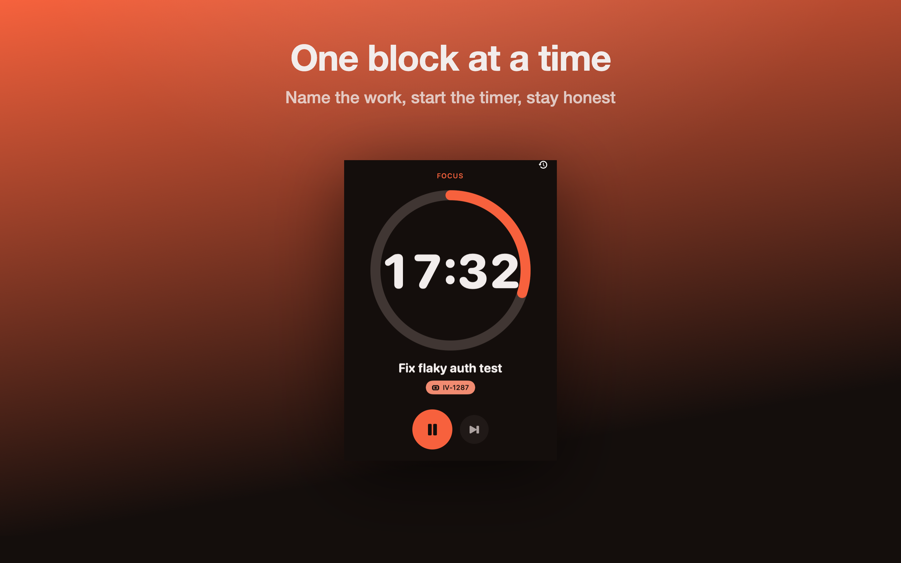
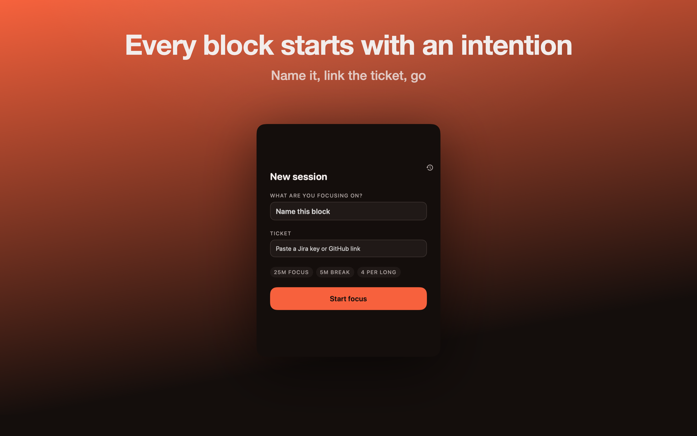
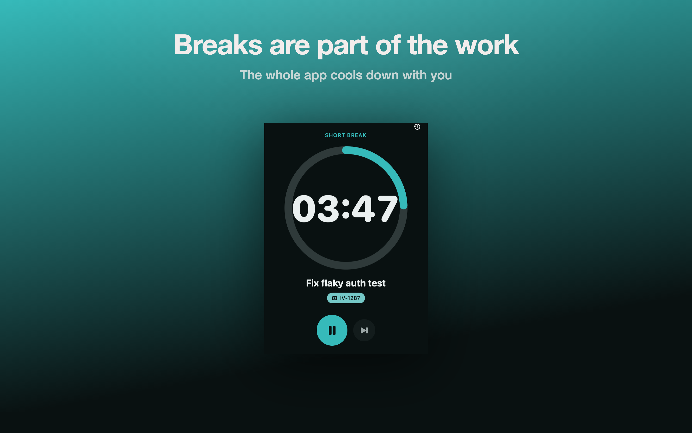
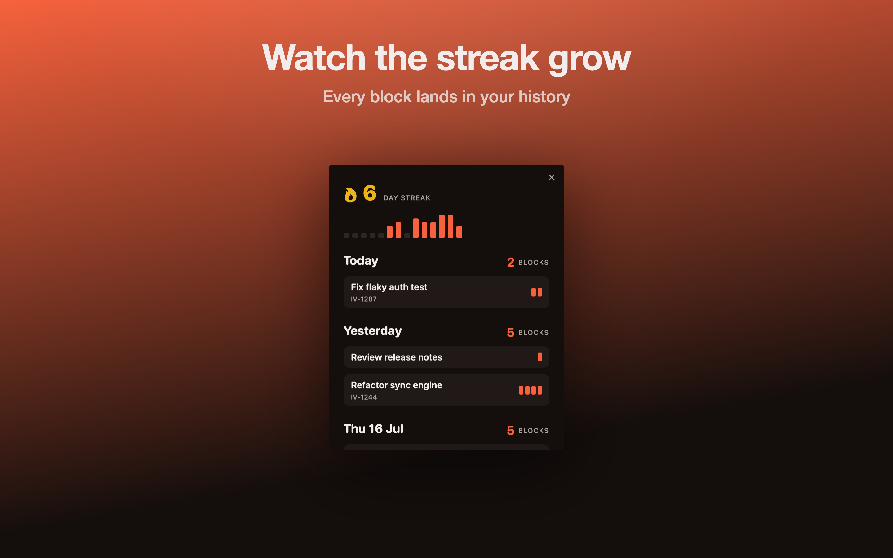
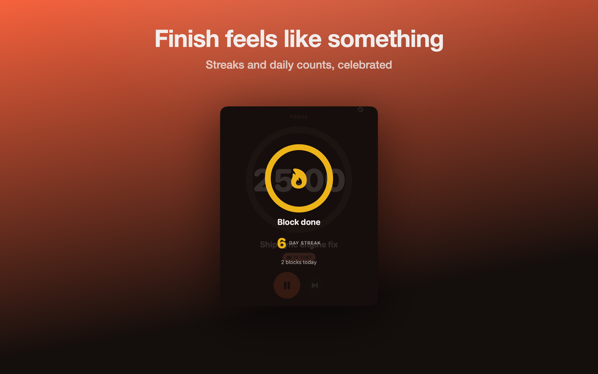

# Pomodoro

A focus timer for the macOS menu bar that makes deep work feel rewarding. Name the block, start the timer, and watch completed blocks turn into a streak.



<table>
  <tr>
    <td></td>
    <td></td>
  </tr>
  <tr>
    <td></td>
    <td></td>
  </tr>
</table>

## Features

- **Lives in the menu bar.** Shows as a popover, a pinned panel or a mini card, with an optional countdown in the menu bar itself.
- **Every block starts with an intention.** Name the work and link a Jira or GitHub ticket before you start.
- **Standard cycle.** 25-minute focus blocks, 5-minute short breaks and a 15-minute long break after every 4 blocks.
- **Floating orb.** A timer ring that sits in a screen corner above every app. When you've been idle a while, it nudges you to start the next block.
- **Streaks and history.** Every finished block is logged, and daily counts and streaks get celebrated.
- **Keyboard first.** <kbd>Space</kbd> pauses or resumes, <kbd>→</kbd> skips.
- **Peon mode.** Optional sound pack for session start, completion, pause and back-to-work.
- **Launch at login.**

## Install

1. Download the latest `Pomodoro-<version>.dmg` from [Releases](https://github.com/wezzcoetzee/pomodoro/releases).
2. Open the DMG and drag **Pomodoro** into **Applications**.
3. Sign the app locally so macOS will open it (see below).

### Signing the downloaded app

Releases are ad-hoc signed, not notarized by Apple, so macOS quarantines the download and Gatekeeper refuses to open it ("Pomodoro is damaged" or "cannot be verified"). After you copy it into Applications, clear the quarantine flag and re-sign it with your own local ad-hoc identity:

```sh
xattr -cr /Applications/Pomodoro.app
codesign --force --deep --sign - /Applications/Pomodoro.app
```

To skip the warning before opening the DMG at all, you can also clear the flag on the downloaded file:

```sh
xattr -d com.apple.quarantine ~/Downloads/Pomodoro-*.dmg
```

Requires macOS 14 (Sonoma) or later.

## Build from source

You'll need Xcode and [XcodeGen](https://github.com/yonaskolb/XcodeGen) (`brew install xcodegen`).

```sh
xcodegen generate                     # creates Pomodoro.xcodeproj from project.yml
open Pomodoro.xcodeproj               # run the Pomodoro scheme
```

Run the tests:

```sh
xcodebuild test -project Pomodoro.xcodeproj -scheme Pomodoro
```

Build a signed `.zip` and `.dmg` into `dist/`:

```sh
./release.sh 0.2.0
```

Pushing a `v*` tag runs the same script in CI and publishes a GitHub release.

## Project layout

| Path | What's there |
| --- | --- |
| `Sources/Pomodoro/Core` | Timer engine, session store, preferences. Pure logic, no UI. |
| `Sources/Pomodoro/Shell` | AppKit glue: status item, floating panel, orb, alerts, sounds. |
| `Sources/Pomodoro/Surfaces` | SwiftUI views and the shared `AppModel`. |
| `Tests/PomodoroTests` | Unit tests for the core logic. |
| `screenshots/` | App Store screenshots: `raw/` captures, `framed/` composites, and the `manifest.json` that drives them. |
| `PRODUCT.md`, `DESIGN.md` | Product intent and the design system. |

## License

[MIT](LICENSE)
